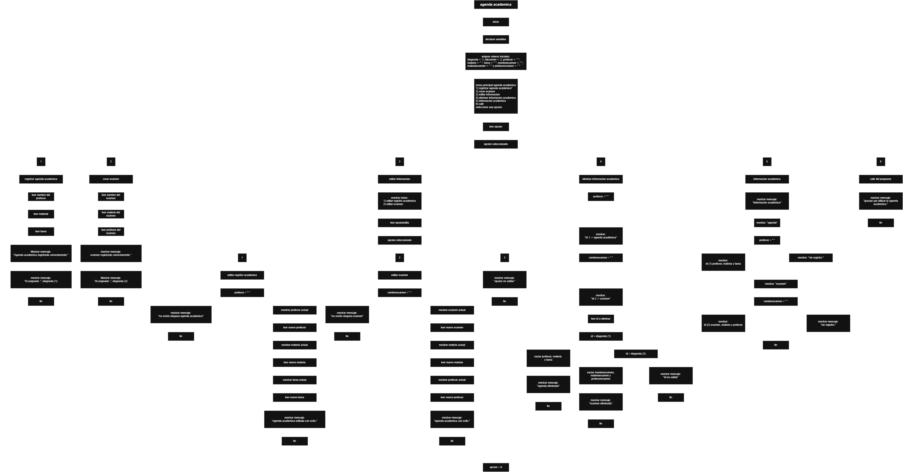

Este proyecto, llamado <b>agenda académica</b>, fue desarrollado en <b>pseint</b> como un ejercicio práctico para fortalecer la lógica de programación mediante la creación de un sistema de gestión académica desde la consola. El programa cuenta con un menú principal de seis opciones que permite <b>registrar una agenda académica, crear exámenes, editar información, eliminar registros, consultar información académica y salir del sistema</b>. La agenda académica almacena el nombre del profesor, la materia y la tarea, mientras que el examen guarda su nombre, la materia correspondiente y el profesor encargado. Cada tipo de registro utiliza un identificador fijo para distinguir la agenda académica del examen. Durante su desarrollo se aplicaron conceptos fundamentales de programación, como variables, cadenas de texto, estructuras condicionales, ciclos repetitivos y estructuras de selección. Este proyecto permite poner en práctica los conocimientos adquiridos en PSeInt y sirve como base para desarrollar sistemas de gestión académica más avanzados utilizando otros lenguajes y tecnologías.

<h2 align="center">⚙️ Funcionamiento del menú principal</h2>

### ➕ Registrar agenda académica

La opción <b>1) registrar agenda académica</b> permite almacenar la información de una agenda académica dentro del programa. Para realizar el registro, el sistema solicita al usuario el <b>nombre del profesor, la materia y la tarea</b>. Los datos introducidos se guardan en las variables <b>profesor, materia y tarea</b>, respectivamente. Después de completar el proceso, el programa muestra el mensaje <b>"agenda academica registrada correctamente."</b> y presenta el identificador asignado mediante la variable <b>idagenda</b>, cuyo valor inicial es <b>1</b>. En el código actual se utiliza un único conjunto de variables para almacenar la agenda académica, por lo que, si se realiza otro registro, la información anterior se sustituye por los nuevos datos. El programa no cuenta con una estructura que permita almacenar múltiples agendas de manera independiente.

### 📝 Crear examen

La opción <b>2) crear examen</b> permite registrar la información de un examen académico. Primero, el programa solicita el <b>nombre del examen, la materia del examen y el profesor encargado</b>. Los datos se almacenan en las variables <b>nombreexamen, materiaexamen y profesorexamen</b>. Una vez introducida la información, el sistema muestra el mensaje <b>"examen registrado correctamente."</b> y presenta el identificador asignado mediante la variable <b>idexamen</b>, cuyo valor inicial es <b>2</b>. Al igual que sucede con la agenda académica, el programa utiliza un único conjunto de variables para guardar la información del examen. Por este motivo, cuando se crea otro examen, los datos almacenados anteriormente se reemplazan. El código actual no implementa arreglos ni un sistema de almacenamiento que permita administrar varios exámenes simultáneamente.

### ✏️ Editar información

La opción <b>3) editar información</b> permite modificar los datos almacenados en la agenda académica o en el examen. Al seleccionar esta opción, el programa presenta un submenú con dos alternativas: <b>1) editar registro académico</b> y <b>2) editar examen</b>. Si el usuario selecciona la primera opción, el sistema comprueba si la variable <b>profesor</b> está vacía. Cuando no existe información registrada, muestra el mensaje <b>"no existe ninguna agenda academica."</b>. Si existe una agenda, presenta los valores actuales del profesor, la materia y la tarea, y solicita los nuevos datos para actualizar las variables correspondientes. Si el usuario selecciona la segunda opción, el programa realiza una comprobación similar mediante la variable <b>nombreexamen</b>. Cuando no existe ningún examen, muestra el mensaje <b>"no existe ningun examen."</b>. En caso contrario, permite modificar el nombre del examen, la materia y el profesor. Al finalizar cualquiera de las dos operaciones, muestra un mensaje de confirmación. Si se introduce una opción diferente de las disponibles en el submenú, se presenta el mensaje <b>"opcion no valida."</b>.

### 🗑️ Eliminar información académica

La opción <b>4) eliminar información académica</b> permite borrar la información almacenada de la agenda académica o del examen mediante su identificador. Primero, el programa comprueba si existen registros y muestra el id de la agenda académica, correspondiente al valor <b>1</b>, cuando la variable <b>profesor</b> no está vacía. De manera similar, muestra el id del examen, correspondiente al valor <b>2</b>, cuando la variable <b>nombreexamen</b> contiene información. Después, solicita al usuario el identificador que desea eliminar y almacena el valor introducido en la variable <b>ideliminar</b>. Si el identificador coincide con <b>idagenda</b>, el programa asigna cadenas vacías a las variables <b>profesor, materia y tarea</b>, eliminando la información de la agenda. Si coincide con <b>idexamen</b>, limpia las variables <b>nombreexamen, materiaexamen y profesorexamen</b>. En ambos casos, muestra un mensaje de confirmación. Si el identificador no coincide con ninguno de los dos valores contemplados, presenta el mensaje <b>"id no valido."</b>. En el código actual, la eliminación se realiza limpiando las variables, sin modificar los identificadores asignados. Además, la comprobación del id no verifica si el registro correspondiente existe antes de mostrar el mensaje de eliminación.

### 📋 Información académica

La opción <b>5) información académica</b> permite consultar los datos almacenados en el programa. Primero, muestra la sección correspondiente a la agenda académica y comprueba si la variable <b>profesor</b> está vacía. Si no existe un registro, presenta el mensaje <b>"sin registro."</b>. En caso contrario, muestra el identificador de la agenda, el nombre del profesor, la materia y la tarea. Después, el programa presenta la sección del examen y comprueba si la variable <b>nombreexamen</b> está vacía. Si no existe un examen registrado, muestra nuevamente el mensaje <b>"sin registro."</b>. Si existe información, presenta el identificador del examen, su nombre, la materia y el profesor correspondiente. Esta operación permite consultar los registros disponibles desde una misma opción del menú principal, sin necesidad de acceder por separado a cada tipo de información.

### 🚪 Salir del menú principal

La opción <b>6) salir</b> permite finalizar la ejecución de la agenda académica. El menú principal se encuentra dentro de una estructura repetitiva <b>repetir ... hasta que</b>, que mantiene el programa en funcionamiento mientras el usuario realiza las operaciones disponibles. La condición <b>hasta que opcion = 6</b> determina cuándo debe finalizar el ciclo. Cuando el usuario selecciona la opción 6, el programa muestra el mensaje <b>"gracias por utilizar la agenda academica."</b> y termina la ejecución. Además, el código contiene una condición que comprueba si la opción seleccionada es diferente de 6 antes de mostrar el mensaje <b>"presione una tecla para continuar..."</b>. De esta manera, el usuario puede leer los resultados de cada operación antes de regresar al menú principal, sin tener que realizar una pausa adicional al salir.

<h2 align="center">🧠 Temas aplicados en el proyecto</h2>

### 📦 Variables

En este proyecto se utilizan variables de tipo <b>entero</b> y <b>cadena</b> para controlar el funcionamiento del menú principal, gestionar la edición de información, identificar los registros y almacenar los datos académicos. Las variables enteras permiten guardar las opciones seleccionadas y los identificadores de los registros, mientras que las variables de cadena almacenan los nombres, las materias y las tareas introducidas por el usuario. Cada variable cumple una función específica dentro de las operaciones de registro, edición, eliminación y consulta de la información académica.

🔢 **Opcion:** Almacena el número de la opción seleccionada por el usuario en el menú principal.

✏️ **Opcioneditar:** Almacena la opción seleccionada en el submenú de edición de información.

🆔 **Idagenda:** Almacena el identificador de la agenda académica, cuyo valor inicial es 1.

📝 **Idexamen:** Almacena el identificador del examen, cuyo valor inicial es 2.

🗑️ **Ideliminar:** Almacena el identificador introducido por el usuario para seleccionar la información que desea eliminar.

👨‍🏫 **Profesor:** Almacena el nombre del profesor correspondiente a la agenda académica.

📚 **Materia:** Almacena el nombre de la materia de la agenda académica.

📌 **Tarea:** Almacena la descripción de la tarea académica.

📝 **Nombreexamen:** Almacena el nombre del examen registrado.

📚 **Materiaexamen:** Almacena el nombre de la materia correspondiente al examen.

👨‍🏫 **Profesorexamen:** Almacena el nombre del profesor encargado del examen.

### 🔀 Estructuras condicionales

En este proyecto se utilizan las estructuras condicionales <b>si</b> y <b>sino</b> para comprobar si existe información registrada antes de permitir su edición y para determinar qué operación de eliminación debe ejecutarse. Estas condiciones comparan las variables principales de cada registro con una cadena vacía. Si la variable que identifica la existencia de información está vacía, el programa muestra un mensaje indicando que no hay ningún registro disponible. Si contiene información, permite continuar con la operación correspondiente. También se utilizan condiciones para comprobar el identificador introducido durante la eliminación y para determinar si debe mostrarse el mensaje que solicita al usuario presionar una tecla antes de regresar al menú. Estas comprobaciones permiten controlar el comportamiento del programa según los datos almacenados y las opciones seleccionadas.

### 🔄 Estructuras repetitivas

En este proyecto se utiliza el ciclo <b>repetir ... hasta que</b> para mantener activo el menú principal de la agenda académica. Dentro de esta estructura se muestran las opciones disponibles, se recibe la selección del usuario y se ejecutan las instrucciones correspondientes mediante la estructura <b>segun</b>. Al finalizar cada operación, el programa espera que el usuario presione una tecla antes de volver al menú, excepto cuando se selecciona la opción de salida. El ciclo continúa ejecutándose hasta que la variable <b>opcion</b> toma el valor <b>6</b>. Esta estructura permite que el usuario realice varias operaciones consecutivas sin necesidad de reiniciar el programa después de cada consulta, registro, edición o eliminación.

### 🎯 Estructura segun

La estructura <b>segun</b> se utiliza para evaluar el valor almacenado en la variable <b>opcion</b> y ejecutar el bloque de instrucciones correspondiente a la selección del usuario. El menú principal contiene seis casos, desde el número <b>1</b> hasta el número <b>6</b>, asociados al registro de la agenda académica, la creación de exámenes, la edición de información, la eliminación de registros, la consulta de información y la salida del programa. Además, se utiliza una segunda estructura <b>segun</b>, controlada por la variable <b>opcioneditar</b>, para distinguir entre la edición de la agenda académica y la edición del examen. Ambas estructuras incluyen la alternativa <b>de otro modo</b>, que permite mostrar un mensaje cuando el usuario introduce una opción no válida.

### 🔢 Identificadores de los registros

El programa utiliza dos variables enteras para identificar los tipos de información que se administran. La variable <b>idagenda</b> contiene el valor <b>1</b>, que identifica la agenda académica, mientras que <b>idexamen</b> contiene el valor <b>2</b>, que identifica el examen. Estos identificadores se muestran al registrar la información y durante el proceso de eliminación, cuando el registro correspondiente contiene datos. Posteriormente, el usuario puede introducir uno de estos valores para seleccionar qué información desea eliminar. En el código actual, los identificadores se inicializan una sola vez al comienzo del programa y no cambian durante su ejecución. Por lo tanto, no se generan identificadores nuevos para cada registro ni se mantiene un historial de los elementos eliminados.

### 🔤 Cadenas de texto

Las variables de tipo <b>cadena</b> se utilizan para almacenar la información descriptiva de la agenda académica y del examen. Al inicio del programa, estas variables se inicializan con una cadena vacía, representada por <b>""</b>. Posteriormente, reciben los valores introducidos por el usuario durante las operaciones de registro o edición. Las mismas variables se utilizan para mostrar los datos en la consulta de información académica. Durante la eliminación, se vuelven a asignar cadenas vacías para indicar que ya no existe información almacenada en las variables correspondientes. Esta técnica permite distinguir entre un registro con información y uno que ha sido eliminado durante la ejecución.

<h2 align="center">¿Cómo se implementaron las operaciones crud en el proyecto?</h2>

Las operaciones <b>crud</b> se implementaron mediante las opciones del menú principal, permitiendo administrar la información de la agenda académica y del examen. La operación <b>crear</b> corresponde a las opciones <b>registrar agenda académica</b> y <b>crear examen</b>, donde el usuario introduce los datos que desea almacenar. La operación <b>leer</b> se realiza mediante la opción <b>información académica</b>, que permite consultar los datos de ambos tipos de registro. La operación <b>actualizar</b> corresponde a <b>editar información</b>, donde se modifican los campos de la agenda académica o del examen. Finalmente, la operación <b>eliminar</b> se realiza mediante <b>eliminar información académica</b>, que limpia las variables asociadas al registro seleccionado. Estas operaciones utilizan variables, estructuras condicionales y estructuras de selección para administrar la información almacenada temporalmente durante la ejecución del programa.

<h2 align="center">Diagrama de flujo del proyecto</h2>

<h2 align="center">🛡️ Validaciones del programa</h2>

### 📭 No existe una agenda académica

Esta validación se utiliza en la opción <b>editar información</b>, específicamente cuando el usuario selecciona la edición de la agenda académica. El programa comprueba si la variable <b>profesor</b> está vacía mediante la condición <b>profesor = ""</b>. Si se cumple esta condición, muestra el mensaje <b>"no existe ninguna agenda academica."</b> e impide continuar con la edición. En caso contrario, presenta los datos actuales y solicita la nueva información. Esta comprobación permite evitar que el programa solicite cambios para una agenda que no contiene información registrada.

### 📭 No existe un examen

Esta validación se utiliza cuando el usuario selecciona la opción de editar un examen. El programa comprueba si la variable <b>nombreexamen</b> está vacía. Si no existe información almacenada, presenta el mensaje <b>"no existe ningun examen."</b> y no ejecuta el proceso de edición. Si la variable contiene información, el programa muestra los valores actuales y solicita los nuevos datos del examen. De esta manera, se comprueba la existencia de información antes de modificar sus campos.

### ❌ Identificador no válido

Esta validación se utiliza durante la eliminación de información académica. El programa compara el valor introducido en la variable <b>ideliminar</b> con los identificadores <b>idagenda</b> e <b>idexamen</b>. Si coincide con el identificador de la agenda, limpia las variables correspondientes a ese registro. Si coincide con el identificador del examen, limpia las variables asociadas al examen. Cuando el valor introducido no coincide con ninguno de los dos identificadores, muestra el mensaje <b>"id no valido."</b>. Sin embargo, el código actual no comprueba si el registro existe antes de realizar la eliminación. Por este motivo, si el usuario introduce el id de un registro que ya fue eliminado, el programa puede mostrar un mensaje de confirmación aunque las variables ya estén vacías.

### ⚠️ Sobrescritura de información

El programa utiliza un conjunto de variables para almacenar la agenda académica y otro conjunto para almacenar el examen. Por esta razón, cuando el usuario registra una nueva agenda académica, los valores anteriores de <b>profesor, materia y tarea</b> son reemplazados. Del mismo modo, al crear otro examen, los datos anteriores almacenados en <b>nombreexamen, materiaexamen y profesorexamen</b> se sustituyen por los nuevos valores. El código actual no incluye comprobaciones que impidan sobrescribir registros existentes ni utiliza arreglos para conservar múltiples registros independientes. Esta es una limitación de la implementación actual y puede considerarse una mejora para futuras versiones del proyecto.

### 🔢 Identificadores fijos

Los identificadores se definen al comienzo del programa mediante las asignaciones <b>idagenda &lt;- 1</b> e <b>idexamen &lt;- 2</b>. Estos valores permiten distinguir la agenda académica del examen durante las operaciones de consulta y eliminación. Sin embargo, los identificadores no se generan automáticamente ni aumentan después de registrar información. Si un registro se elimina y posteriormente se crea de nuevo, vuelve a utilizarse el mismo identificador correspondiente a su tipo. El código actual no implementa un contador independiente para generar identificadores únicos para cada registro ni permite administrar varios registros del mismo tipo.

### ⚠️ Opción inválida

La estructura <b>segun</b> del menú principal incluye una alternativa <b>de otro modo</b> que muestra el mensaje <b>"opcion no valida."</b> cuando el usuario introduce un número que no corresponde a las opciones disponibles. Esta validación también se encuentra en el submenú de edición, donde se comprueba si la selección corresponde a la edición de la agenda académica o del examen. No obstante, el código actual no incluye una validación específica del tipo de dato introducido en las instrucciones <b>leer</b>. Por lo tanto, la comprobación de opciones no válidas se encuentra implementada para las alternativas numéricas que contempla la estructura de selección, pero no constituye una validación completa de todas las entradas posibles del usuario.

<h2 align="center">🎯 Objetivo del proyecto</h2>

El objetivo principal de este proyecto es fortalecer la <b>lógica de programación</b> mediante el desarrollo de un sistema de gestión académica en <b>pseint</b>. A través de su construcción se busca aplicar los conocimientos adquiridos sobre variables, cadenas de texto, estructuras condicionales, ciclos repetitivos y estructuras de selección, integrándolos para resolver un problema de manera organizada. Además, el proyecto permite comprender cómo registrar, consultar, modificar y eliminar información mediante operaciones crud dentro de una aplicación de consola. La agenda académica constituye una base para futuras mejoras, como la incorporación de múltiples registros, la generación dinámica de identificadores y el almacenamiento permanente de la información utilizando archivos u otras tecnologías.

